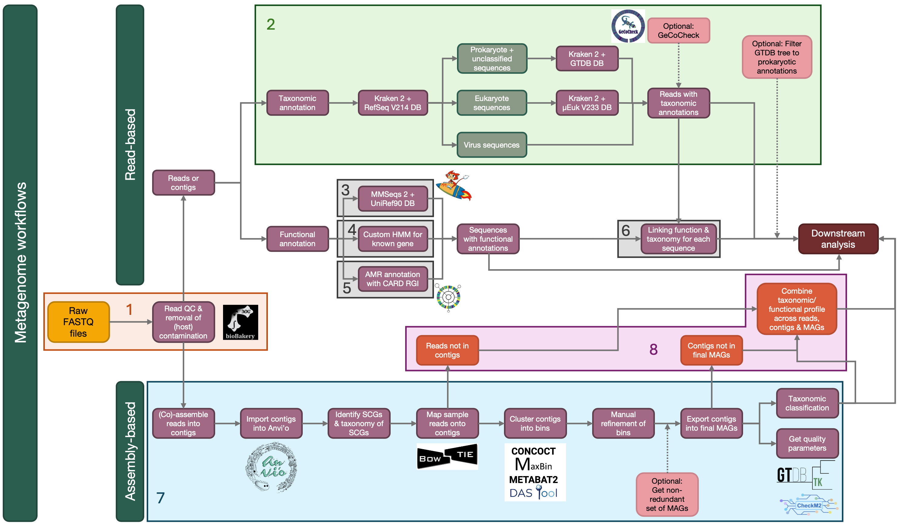

> <i class="fa-solid fa-circle-exclamation"></i> <b>Workflow status:</b> we're still working on this one at the moment. 
{: .alert .alert-primary .p-3}

## Introduction

The aim here is to classify your sequences taxonomically. We're assuming that you're already been through [Metagenome 1 - initial QC](/docs/sop-metagenome-1-initial-qc/) and have quality-controlled metagenomic reads with host-associated reads removed (if appropriate).

In this SOP we use Kraken 2 and a range of different databases to classify our reads taxonomically. This is based on a large amount of experience in trying to figure out the "best" way and our approach has evolved over time.
- When we first started investigating this, we noticed that we got wildly different results using Kraken 2 and MetaPhlAn 3, with MetaPhlAn often not identifying any taxa at all in our samples and Kraken identifying way too many. We published a paper ([Wright et al. 2023](https://www.microbiologyresearch.org/content/journal/mgen/10.1099/mgen.0.000949)) showing that using a confidence threshold with Kraken allowed more accurate taxonomic classification than MetaPhlAn (higher precision) while retaining high recall of taxa.
- As we started to apply this to different projects, particularly environmental ones, we realised that applying confidence thresholds to samples from environments with taxa that do not share great similarity to those in reference databases quickly leads to a very small proportion of reads being classified, and we therefore wanted to investigate other methods that we could apply to our Kraken results to increase the accuracy (decrease the number of false positives).
- We came up with a simple method where the reads from taxa identified by Kraken (or another read-based taxonomic classifier) can be mapped back to the reference genome of the species that they have been identified as. We published that paper ([Wright et al. 2026](https://doi.org/10.1099/mgen.0.001739)) this year, along with a tool that can be used to run these analyses, [GeCoCheck](https://github.com/R-Wright-1/GeCoCheck/wiki).
- We are now wanting to combine this with using the [Genome Taxonomy Database](https://gtdb.ecogenomic.org/) for Kraken (available from the [Langmead lab page](https://benlangmead.github.io/aws-indexes/k2)), which gives more species-level classifications than NCBI taxonomy due to more taxonomic ranks being filled in. We are cautious in that we still want to use a large, complete database as a first pass to avoid [erroneous classifications that can come from incomplete databases](https://pubmed.ncbi.nlm.nih.gov/32106809/).
- Initially we were using a two-step approach where we would do a first round of classification with a large, complete database (such as our RefSeq V214 database described below), filtering out reads that mapped to bacteria/archaea, and running a second classification step on them with the GTDB database. We actually think this is likely more computationally intensive/takes longer to achieve than just classifying all reads with any databases of interest, and so that is what we show here.

This workflow therefore consists of:
- Classifying all reads with Kraken 2 + complete RefSeq V214 database (note that this includes all bacteria + archaea + viruses, only complete eukaryotic genomes, other adapter + plasmid sequences)
- Classifying all reads with Kraken 2 + GTDB r226 database (this includes all GTDB r226 genomes - based on NCBI RefSeq V226 - as well as 52,605 isolate genomes and MAGs from the Mouse Gastrointestinal Bacteria Catalogue (MGBC) and 16,626 MAGs from the Integrated Mouse Gut Metagenome Catalog (iMGMC). See the recent [paper describing GTDB](https://academic.oup.com/nar/article/54/D1/D743/8296754) for further details)
- Classifying all reads with Kraken 2 + NCBI V233 Microeukaryote database (constructed using Genbank fungi + protozoa + RefSeq non-metazoans. This database includes 28,516 genomes)
- Running GeCoCheck on all GTDB r226 and MicroEuk V233 taxonomic annotations
- Combining all taxonomic annotations together for each read and determining which is the taxonomic annotation to use

Note on viral taxonomic annotation: we have not typically worked on samples that have a large viral component and we have therefore not included a step for this analysis. If this is your interest, we suggest investigating other pipelines. 

### Confidence thresholds

## Requirements

We are assuming here that you are already familiar with the command line and can install these packages for yourself. You will need the following conda environments:

* `kraken2-v2.17.1-github` - environment containing 

See our [server setup tutorial](/docs/tutorials/2026-server-setup/) for more information. 

## 1. Taxonomic assignment of sequences using Kraken 2

We recommend Kraken 2 + all NCBI genomes if possible. Kraken non-redundant database is next-best.

Our in-lab database uses an 803 GB database built using RefSeq V214 genomes (803GB; updated version of the best database described in [our paper](https://doi.org/10.1099/mgen.0.000949)): 

- all bacteria + archaea + viruses  
- only complete eukaryotic genomes  
- other adapter + plasmid sequences  

```bash
conda activate kraken2-v2.17.1-github
```

```bash
NCORES=24
```

### 1.1. Build or acquire Kraken 2 database(s)

### 1.2. Run Kraken 2 with complete database

> <i class="fa-solid fa-bell"></i> <b>Confidence thresholds</b><br>
> Some more of a note to go here!
{: .alert .alert-info .p-3}

```bash
mkdir kraken2_outraw_RefSeqV214
mkdir kraken2_kreport_RefSeqV214
```

```bash
parallel -j 1 --eta 'k2 classify \
                     --db /home/shared/RefSeqV214_5Oct2022_AllBacArcVir_CompEuk_KrakOther/ \
                     --use-daemon \
                     --threads $NCORES \
                     --output kraken2_outraw_RefSeqV214/{= s:.*/::; s/_R1\.fastq$// =}.kraken \
                     --report kraken2_kreport_RefSeqV214/{= s:.*/::; s/_R1\.fastq$// =}.kreport \
                     --paired \
                     --use-names {} {= s/_R1\.fastq$/_R2.fastq/ =}' \
                     ::: kneaddata_out/*_R1.fastq

k2 clean --stop-daemon
```

```bash
mkdir kraken2_outraw_RefSeqV220
mkdir kraken2_kreport_RefSeqV220
```

```bash
parallel -j 1 --eta 'k2 classify \
                     --db /bigpool/robyn/kraken2_RefSeqV220/Kraken2_RefSeqV220/ \
                     --use-daemon \
                     --threads $NCORES \
                     --output kraken2_outraw_RefSeqV220/{= s:.*/::; s/_R1\.fastq$// =}.kraken \
                     --report kraken2_kreport_RefSeqV220/{= s:.*/::; s/_R1\.fastq$// =}.kreport \
                     --paired \
                     --use-names {} {= s/_R1\.fastq$/_R2.fastq/ =}' \
                     ::: kneaddata_out/*_R1.fastq

k2 clean --stop-daemon
```

### 1.3. Run Kraken 2 with GTDB

```bash
mkdir kraken2_outraw_GTDBr226
mkdir kraken2_kreport_GTDBr226
```

```bash
parallel -j 1 --eta 'k2 classify \
                     --db /bigpool/shared/kraken_databases/k2_gtdb_genome_reps_20250609/ \
                     --use-daemon \
                     --threads $NCORES \
                     --output kraken2_outraw_GTDBr226/{= s:.*/::; s/_R1\.fastq$// =}.kraken \
                     --report kraken2_kreport_GTDBr226/{= s:.*/::; s/_R1\.fastq$// =}.kreport \
                     --paired \
                     --use-names {} {= s/_R1\.fastq$/_R2.fastq/ =}' \
                     ::: kneaddata_out/*_R1.fastq

k2 clean --stop-daemon
```

### 1.4. Run Kraken 2 with MicroEukaryote database

```bash
mkdir kraken2_outraw_MicroEukV233
mkdir kraken2_kreport_MicroEukV233
```

```bash
parallel -j 1 --eta 'k2 classify \
                     --db /bigpool/shared/kraken_databases/kraken2_microeuk_RefSeqV233/ \
                     --use-daemon \
                     --threads $NCORES \
                     --output kraken2_outraw_MicroEukV233/{= s:.*/::; s/_R1\.fastq$// =}.kraken \
                     --report kraken2_kreport_MicroEukV233/{= s:.*/::; s/_R1\.fastq$// =}.kreport \
                     --paired \
                     --use-names {} {= s/_R1\.fastq$/_R2.fastq/ =}' \
                     ::: kneaddata_out/*_R1.fastq

k2 clean --stop-daemon
```

## 2. Run GeCoCheck

### 2.1. On GTDB classifications

Here, GeCoCheck is expecting you to have a metadata file that has two columns, one containing sample ID's and a second with a metadata category of interest. You should also change the `project_name` to something descriptive.

```bash
conda activate GeCoCheck-v0.0.5

mkdir GeCoCheck_out_GTDB_r226
cp /bigpool/shared/GeCoCheck/gtdb_genomes/assembly_summary_* GeCoCheck_out_GTDB_r226/

coverage_pipeline.py \
            --processors $NCORES \
            --sample_metadata metadata.csv \
            --project_name project_name \
            --fastq_dir kneaddata_out_rename \
            --kraken_kreport_dir two_step_classification/kraken2_kreport_prok_rename \
            --kraken_outraw_dir two_step_classification/kraken2_outraw_prok_rename \
            --output_dir GeCoCheck_out_GTDB_r226 \
            --genome_dir /bigpool/shared/GeCoCheck/gtdb_genomes/gtdb_genomes \
            --bowtie2_db_dir /bigpool/shared/GeCoCheck/gtdb_genomes/bowtie2_db \
            --coverage_program Bowtie2 \
            --read_lim 100 \
            --paired
```


## 2. Separation of sequences into different domains

### 2.1. Get bacterial, archaeal, and unclassified sequences

### 2.2. Get eukaryotic sequences

### 2.2.1. Get all eukaryotic sequences

### 2.2.2 Get non-metazoan sequences

### 2.3. Get viral sequences

## 3. Classify bacteria, archaeal, and unclassified with Kraken 2 + GTDB database

### 3.1. Run Kraken 2

### 3.2. Run GeCoCheck

### 3.3. Filter results based on GeCoCheck output

## 4. Classify non-metazoan eukaryotes with Kraken 2 + microEuk database

### 4.1. Run Kraken 2

### 4.2. Run GeCoCheck

### 4.3. Filter results based on GeCoCheck output

## 5. Collate all output

```bash
collate_taxonomy.py --initial 
```

## Authors

**Authors:** Robyn Wright, Dhwani Desai, Gina Filloramo & André Comeau<br>
**First created:** 2 June 2021<br>
**Last updated:** 16 October 2026<br>
**Based on initial versions by:** André Comeau ([Metagenomics Standard Operating Procedure v3](https://github.com/LangilleLab/microbiome_helper/wiki/Metagenomics-Standard-Operating-Procedure-v3)) and Robyn Wright ([Microbiome Helper 2 Annotation of reads with Kraken2 (and taxonomic profiling with Bracken)](https://github.com/LangilleLab/microbiome_helper/wiki/Microbiome-Helper-2-Annotation-of-reads-with-Kraken2-(and-taxonomic-profiling-with-Bracken)))


